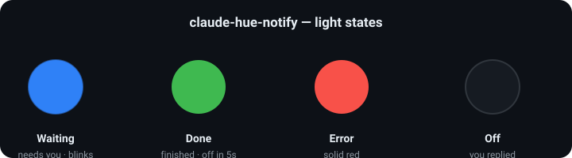

# 💡 claude-hue-notify

> Turn a **Philips Hue** light into an ambient status indicator for **[Claude Code](https://claude.com/claude-code)**.

<p>
  
  
  
  
</p>

Glance at your desk lamp instead of your screen: it goes **blue** when Claude needs you, **green** when it's done, and turns **off** the moment you reply.



- 🔵 **Blue, blinking** — Claude needs you (asking a question, requesting permission, or idle waiting)
- 🟢 **Green** — Claude finished a turn; auto-off after 5s
- 🔴 **Solid red** — error (manual/optional)
- ⚫ **Off** — you replied (typed a message or answered a question dialog)

The plugin also gives Claude an **MCP server** for the lights: ask *"dim the desk lamp to 30%"*, *"switch on the Relax scene"* or *"pause the notifier for an hour"*. See [Claude controls the lights (MCP)](#claude-controls-the-lights-mcp).

Works across **every** Claude Code session (any project, any terminal/IDE, several at once) via your **global** `~/.claude/settings.json`. Single dependency-free Python file talking to the bridge's **local** REST API — nothing leaves your network.

---

## Contents

- [Install as a plugin (recommended)](#install-as-a-plugin-recommended)
- [Quick start (standalone script)](#quick-start-standalone-script)
- [How it works](#how-it-works)
- [Requirements](#requirements)
- [Manual setup](#manual-setup)
- [Installing / removing the hooks](#installing--removing-the-hooks)
- [CLI usage](#cli-usage)
- [Claude controls the lights (MCP)](#claude-controls-the-lights-mcp)
- [Customizing](#customizing)
- [Notes & limitations](#notes--limitations)
- [Troubleshooting](#troubleshooting)

---

## Install as a plugin (recommended)

This repo is a [Claude Code plugin](https://docs.claude.com/en/docs/claude-code/plugins) — the hooks install themselves, no editing `settings.json`.

In Claude Code:

```
/plugin marketplace add oguzhanT/claude-hue-notify
/plugin install hue-notify@claude-hue-notify
```

Then pair your bridge & pick a light **once** (creates `~/.config/hue-notify/config.json`):

```bash
python3 ~/.claude/plugins/*/hue-notify/hue-notify.py pair
# or from a clone:  python3 hue-notify.py pair
```

Restart Claude Code and you're done. 🎉 Remove anytime with `/plugin uninstall hue-notify`.

> The plugin ships the hooks and script; `pair` only handles the one-time bridge token + light selection (Philips requires the physical button press, which can't be automated).

---

## Quick start (standalone script)

Prefer not to use the plugin system? Clone and run the wizard:

```bash
git clone https://github.com/oguzhanT/claude-hue-notify.git
cd claude-hue-notify
./setup.sh
```

`setup.sh` walks you through everything:

1. 🔍 Discovers your bridge IP (Philips cloud discovery, or asks you).
2. 🔗 Prompts you to **press the bridge's round link button**, then creates an API token.
3. 💡 Lists your lights and lets you **pick which one** is the notifier.
4. 📝 Writes `~/.config/hue-notify/config.json`.
5. ✅ Runs a quick green-light test.
6. 🪝 Offers to **add the hooks to `~/.claude/settings.json` automatically** (safe merge + backup).

Then **restart Claude Code** (open a new session) and you're done. 🎉

---

## How it works

Claude Code fires [hooks](https://docs.claude.com/en/docs/claude-code/hooks) on session events. This project maps those events to a small script that sets your Hue light over the bridge's local API (`http://<bridge-ip>/api/<token>/lights/<id>/state`).

| Claude Code event | Meaning | Light |
|---|---|---|
| `Notification` | needs permission / idle waiting | 🔵 blue blink |
| `PreToolUse` (matcher `AskUserQuestion`) | about to ask you a question | 🔵 blue blink |
| `Stop` | finished a turn | 🔵 blue if the last message ends with `?`, else 🟢 green → off after 5s |
| `PostToolUse` (matcher `AskUserQuestion`) | you answered/cancelled the question | ⚫ off |
| `UserPromptSubmit` | you sent a message | ⚫ off |

The `Stop` handler is **smart**: it reads the hook's transcript and, if Claude's final message is a question, keeps the light **blue** instead of falsely signalling success.

---

## Requirements

- A Philips Hue Bridge on the same LAN, with at least one **color** bulb
- Python 3 (macOS/Linux already have it — `python3 --version`)
- Claude Code

---

## Manual setup

<details>
<summary>Prefer to do it by hand? Expand.</summary>

### 1. Find your bridge IP

```bash
curl -s https://discovery.meethue.com          # cloud discovery
# or via mDNS on macOS:
dns-sd -B _hue._tcp                             # find the bridge name
```

### 2. Create an API token (pair)

Press the round **link button** on top of the bridge, then within 30s:

```bash
curl -X POST http://<BRIDGE_IP>/api/ \
  -H 'Content-Type: application/json' \
  -d '{"devicetype":"claude_hue_notify#mac"}'
# -> [{"success":{"username":"<YOUR_TOKEN>"}}]
```

If you see `link button not pressed`, press it and retry.

### 3. config.json

```bash
mkdir -p ~/.config/hue-notify
cp config.example.json ~/.config/hue-notify/config.json
# edit bridge_ip + token, then list lights to find the id you want:
python3 hue-notify.py list
#   [7] 'Hue color lamp 1' | type: Extended color light | color: yes
```

`~/.config/hue-notify/config.json` (git-ignored — keep your token private):

```json
{
  "bridge_ip": "192.168.0.4",
  "token": "YOUR_HUE_API_TOKEN",
  "light_id": "7"
}
```

> Keep the repo anywhere; point the script elsewhere with the `HUE_NOTIFY_CONFIG` env var if you don't want `~/.config/hue-notify/`.

### 4. Install the hooks

```bash
python3 install-hooks.py
```

Then **restart Claude Code**.

</details>

---

## Installing / removing the hooks

A dedicated helper keeps `~/.claude/settings.json` tidy — it **backs up** the file, **merges** without touching your own hooks, and is fully **idempotent**:

```bash
python3 install-hooks.py                 # add / update our hooks
python3 install-hooks.py --remove        # cleanly remove only our hooks
python3 install-hooks.py --settings /custom/settings.json
python3 install-hooks.py --script /abs/path/hue-notify.py
```

Prefer copy-paste? Add this to your global `~/.claude/settings.json` (replace `/path/to`):

<details>
<summary>Show hooks JSON</summary>

```json
"hooks": {
  "Notification":     [ { "hooks": [ { "type": "command", "command": "python3 /path/to/claude-hue-notify/hue-notify.py waiting" } ] } ],
  "PreToolUse":       [ { "matcher": "AskUserQuestion", "hooks": [ { "type": "command", "command": "python3 /path/to/claude-hue-notify/hue-notify.py waiting" } ] } ],
  "PostToolUse":      [ { "matcher": "AskUserQuestion", "hooks": [ { "type": "command", "command": "python3 /path/to/claude-hue-notify/hue-notify.py off" } ] } ],
  "UserPromptSubmit": [ { "hooks": [ { "type": "command", "command": "python3 /path/to/claude-hue-notify/hue-notify.py off" } ] } ],
  "Stop":             [ { "hooks": [ { "type": "command", "command": "python3 /path/to/claude-hue-notify/hue-notify.py stop" } ] } ]
}
```

</details>

**Restart Claude Code** (open a new session) for hooks to load.

---

## CLI usage

```bash
python3 hue-notify.py waiting   # blue, blinks ~15s
python3 hue-notify.py done      # green, auto-off after 5s
python3 hue-notify.py error     # solid red
python3 hue-notify.py working   # solid blue
python3 hue-notify.py warning   # solid amber
python3 hue-notify.py off       # off
python3 hue-notify.py list      # list bridge lights
python3 hue-notify.py pair      # interactive: pair bridge, pick a light, write config
python3 hue-notify.py stop      # (used by the Stop hook; reads hook JSON on stdin)
```

## Claude controls the lights (MCP)

Installed as a plugin, claude-hue-notify also starts an MCP server (`mcp_server.py`, stdlib only) that uses the bridge you paired. Claude gets these tools:

| Tool | What it does |
|---|---|
| `hue_status` | Bridge address, the notifier's lamps, whether signals are paused |
| `hue_list_lights` | Lights with on/off, brightness and color support |
| `hue_set_light` | Switch, dim (`brightness` %), color (`#hex`) or white tone (`color_temperature` K) one light, with an optional fade |
| `hue_signal` | `attention`, `success`, `error`, `warning`, `working` or `off` on the notifier's lamps or named ones; respects pause |
| `hue_list_scenes` / `hue_activate_scene` | Saved scenes, by name or id |
| `hue_pause` / `hue_resume` | Pause signals for some minutes or until resumed |

Claude Code asks before running a tool that changes something, the same as for any MCP tool. Run `/mcp` to see the server's state.

Using the script without the plugin? Add the server yourself:

```bash
claude mcp add hue -- python3 /path/to/claude-hue-notify/mcp_server.py
```

## Customizing

Open `hue-notify.py`:

- **Colors** — `COLORS` (Hue `hue` 0–65535, `sat` 0–254).
- **Per-state behavior** — `STATES` (`bri` brightness; `alert: "lselect"` = blink ~15s, `"none"` = steady).
- **Auto-off delay** — `DONE_OFF_AFTER` (seconds).

### Several lamps

Add `light_ids` to `config.json` to drive more than one lamp. It takes precedence over `light_id`; if one lamp is unreachable the others still change.

```json
{ "bridge_ip": "192.168.1.2", "token": "<YOUR_TOKEN>", "light_id": "7", "light_ids": ["7", "12"] }
```

### Shared with the PHP library and HueBar

[philips-hue-client](https://github.com/oguzhanT/philips-hue-client) (`$client->signal()`, `hue signal`) and the HueBar menu bar app use the same states, lamps (`light_ids`) and pause file; [docs/signals.md](https://github.com/oguzhanT/philips-hue-client/blob/main/docs/signals.md) is the contract. `attention` and `success`, the PHP names, work here too. When the notifier changes a lamp, it drops any state another sender was waiting to restore on it, so its newer state stays.

### Pausing

While a file named `paused` exists next to `config.json` (`~/.config/hue-notify/paused`), the notifier makes no light changes. An empty file pauses until you delete it; a unix timestamp in it pauses until that time.

```bash
touch ~/.config/hue-notify/paused                                    # pause
echo $(( $(date +%s) + 3600 )) > ~/.config/hue-notify/paused         # pause for an hour
rm ~/.config/hue-notify/paused                                       # resume
```

The [HueBar](https://github.com/oguzhanT/philips-hue-client/tree/main/macos/HueBar) menu bar app sets both from its menu:


---

## Notes & limitations

- **Shared lights.** With multiple concurrent sessions they all drive the same light(s); the last event wins. It signals "at least one session needs you / finished", not which one.
- **No native error event.** Claude Code has no clean "error" hook, so `error` (red) isn't auto-wired — call it yourself or add a custom hook.
- **Hooks run commands on your machine.** Review any hook before adding it. This one only talks to your local bridge and never blocks a turn (it exits 0 on any failure).

## Troubleshooting

| Problem | Fix |
|---|---|
| `link button not pressed` | Press the bridge button, retry within 30s. |
| Light never changes | Run `python3 hue-notify.py done` manually; check `bridge_ip`/`token`/`light_id`; ping the bridge. |
| Hooks don't fire | Restart Claude Code; validate JSON: `python3 -c "import json;json.load(open('$HOME/.claude/settings.json'))"`. |
| Blue doesn't blink | Some bulbs support `lselect` weakly — increase `bri` or use a proper color bulb. |
| Want it gone | `python3 install-hooks.py --remove` and delete `~/.config/hue-notify/`. |

## License

MIT © 2026 Oğuzhan Togay
